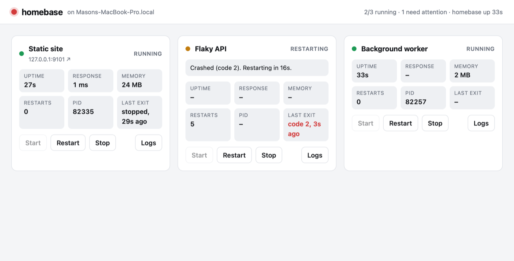

# homebase

A small process supervisor and dashboard for the apps I self-host on my
Windows desktop. It starts them at boot, restarts them when they crash,
health-checks them, and gives me one page (over Tailscale) to watch and
control them all. Add an app to a JSON file and it appears on the dashboard.

Written in Go with the standard library only: one `.exe`, no runtime to install.

<picture>
  <source media="(prefers-color-scheme: dark)" srcset="docs/dashboard-dark.png">
  
</picture>

## What it does

- **Starts every app** in `homebase.json` when it launches, with that app's
  own folder, arguments, and environment variables.
- **Restarts crashes** with exponential backoff (1s, 2s, 4s … up to 1 min),
  so a broken app doesn't spin the CPU. An app that ran stably for a minute
  gets a fresh backoff.
- **Health checks** each app's URL: status, response time, and optionally a
  restart after N failures in a row (a hung server that's still "running").
- **Tracks** uptime, memory, restart count, PID, and how/when it last exited.
- **Live logs:** stdout, stderr and homebase's own notes, streamed to the
  dashboard and saved to `logs/<app>.log` (rotated at 5 MB).
- **Start / Stop / Restart** buttons per app.
- **Never duplicates an app:** if something is already answering on an app's
  health URL (say, the old startup task), homebase reports it as *External*
  instead of starting a second copy that would fail on "port in use".
- **Phone alerts** through [ntfy](https://ntfy.sh): a crash loop, an app that
  crashed for good, or failing health checks, then a follow-up when it
  recovers. Optionally a morning "desktop is up: 2/2 apps running" check-in.
- **Leaves no orphans:** every app is placed in a Windows
  [Job Object](https://learn.microsoft.com/windows/win32/procthread/job-objects)
  that closes with homebase, so even if homebase is force-killed, Windows ends
  its apps too.

## Configuration

```jsonc
{
  "listen": "0.0.0.0:8090",        // dashboard address (firewalled to Tailscale)
  "log_dir": "logs",
  "apps": [
    {
      "name": "jobtracker",                      // ID used in URLs and log files
      "title": "Job Tracker",
      "dir": "C:\\Users\\Admin\\apps\\jobtracker",
      "command": "JobTracker.exe",               // relative to dir, or on PATH
      "args": ["--urls", "http://0.0.0.0:5206"],
      "env": { "ASPNETCORE_ENVIRONMENT": "Production" },
      "env_file": "C:\\Users\\Admin\\apps\\jobtracker\\jobtracker.env",  // secrets, never committed
      "url": "http://arkans-pc1:5206/",          // link on the dashboard
      "health": "http://127.0.0.1:5206/",        // polled for up/down
      "autostart": true,
      "restart": "on-failure",                   // or "always" / "never"
      "restart_when_unhealthy": true,
      "unhealthy_after": 3,
      "health_interval_sec": 15,
      "stop_timeout_sec": 10,
      "source": {                                // optional: lets update.ps1 pull and rebuild it
        "repo_dir": "C:\\Users\\Admin\\projects\\job-tracker",
        "build": ["dotnet", "publish", "src\\JobTracker", "-c", "Release", "-o", "C:\\Users\\Admin\\apps\\jobtracker"]
      }
    }
  ]
}
```

Only `name`, `dir` and `command` are required. **To add a project:** add an
entry, check it, then restart homebase:

```powershell
.\homebase.exe -check -config homebase.json   # validates paths, commands and env files; starts nothing
schtasks /End /TN homebase; schtasks /Run /TN homebase
```
 Unknown keys are rejected, so typos fail loudly
instead of being silently ignored. The desktop's real config is in
[`deploy/homebase.json`](deploy/homebase.json).

**Apps that usually run on their own** (Ollama, started by its tray app):
homebase shows them as "external" instead of starting a second copy. Two
optional keys make that tidy:

- `"log_file"`: a log the program writes itself, shown in the card's Logs
  panel (`"${LOCALAPPDATA}\\Ollama\\server.log"`; `${VAR}`s are expanded).
  Homebase follows it, including after the program rotates it.
- `"log_skip"`: patterns (Go regular expressions) for lines to leave out of
  that log, e.g. `["GET\\s+\"/api/(version|ps|tags)\""]` for Ollama, whose log
  would otherwise be mostly homebase's own health checks and the chat page's
  load monitor asking what's loaded.
- `"external_ok": true`: running outside homebase is normal for this app, so
  the card is green ("Running (own app)") rather than asking you to stop the
  other copy. If it isn't running at all, homebase starts it as usual.
- `"yield_to": "ollama app.exe"`: the program that normally runs this app.
  While it's running, homebase doesn't start its own copy, and it stops its
  copy when that program starts (Ollama's tray app installs updates as it
  starts and can't replace `ollama.exe` while homebase's copy holds it). If
  nothing answers within 3 minutes, homebase starts its copy anyway.

## Phone alerts

| Event | When | Priority |
|---|---|---|
| Crash loop | 3+ restarts within 10 minutes (configurable) | urgent |
| Crashed | exited and its restart policy says don't restart | urgent |
| Unhealthy | running, but the health check failed 3 times in a row | high |
| Recovered | an app you were alerted about is healthy again (a crash-looper must stay up for 2 min) | normal |
| Startup summary | about a minute after homebase starts, if `startup_summary` is on | low |

Deliberately quiet: a single crash that recovers on its own, apps you stopped
yourself, and states in transition (starting, stopping) don't notify.
Problems found at the same moment arrive as one notification, tapping it opens
the dashboard, and if the network isn't up yet (right after boot) delivery is
retried.

Setup:
1. Install the ntfy app on your phone and subscribe to a topic with a long
   random name. Anyone who guesses it can read your alerts.
2. On the desktop, create `C:\Users\Admin\apps\homebase\homebase.env`
   (see [`deploy/homebase.env.example`](deploy/homebase.env.example)) containing
   `NTFY_URL=https://ntfy.sh/<your-topic>`.
3. Test it: `homebase.exe -test-alert -config homebase.json`

```jsonc
"alerts": {
  "env_file": "C:\\Users\\Admin\\apps\\homebase\\homebase.env",  // holds NTFY_URL (keep it out of git)
  "dashboard_url": "http://arkans-pc1:8090/",   // opened when you tap a notification
  "startup_summary": true,
  "crash_loop_restarts": 3,
  "crash_loop_window_min": 10
}
```

A missing or broken alerts config never stops homebase. It logs a warning to
`logs\homebase.log` and runs without alerts.

## Chat with the desktop's models

With an `"ai"` section in `homebase.json`, homebase is also the door to the
models [Ollama](https://ollama.com) runs on this PC's GPU (Qwen and friends),
so you can use them from the Mac or your phone over Tailscale:

```jsonc
"ai": {
  "ollama": "http://127.0.0.1:11434",   // the default; Ollama stays on this PC only
  "default_model": "qwen3-coder:30b"
}
```

- **Local AI page** (`ai.html`, also what `/ollama` opens in a browser): the
  dashboard's "Local AI →" link. It shows whether Ollama is up, the models
  on the PC (each with a Chat button), the address to give Loom with a Copy
  button, and the endpoints other tools can use, with a curl example.
- **In the browser:** `chat.html`: pick a model, ask, and the answer streams in. Stop cancels
  the request (and the generation). Conversations stay in that browser's
  local storage.
- **From Loom** (or any Ollama client that takes a base URL): set its server
  to `http://arkans-pc1:8090/ollama`. Loom's Local AI view can then read
  and, with your approval, edit files on the Mac while the model runs here.

What's reachable, in `internal/ai`: `GET /ollama/api/version`,
`GET /ollama/api/tags`, `GET /ollama/api/ps`, `POST /ollama/api/chat` and
`POST /ollama/api/generate` (Loom's inline completions) and `POST /ollama/api/embed`
(Loom's search by meaning), nothing else (no pulling,
deleting or creating models). Ollama itself doesn't need to listen on the
network or get its own firewall rule. A chat, generate or embed request needs the same
`X-Homebase` header and same-site check as the app buttons, must name a model
and carry messages, and is capped at 8 MB. The browser's own headers (Origin,
cookies) aren't passed on.

Without an `"ai"` section nothing changes: the link stays hidden and the
`/ollama/` routes don't exist.

**Watching the PC's load.** The chat page has a live strip: GPU load, VRAM,
the GPU's temperature, RAM, CPU, and the loaded model with how much of it
fits on the GPU (from Ollama's `/api/ps`). GPU readings come from
`nvidia-smi`, which NVIDIA's driver installs; without it they're left out.
The chat, dashboard and Local AI pages also show a warning in the corner
when, for a couple of readings in a row, VRAM is over 95%, RAM over 90%, the
CPU over 95%, the GPU at 85°C or more, or a model doesn't fit on the GPU (it
then runs partly from system RAM, much slower). Warnings clear by themselves
once things settle; Dismiss hides one until it happens again. The limits are
at the top of `internal/web/static/monitor.js`.

## Projects: what changed on the desktop

To check on work done on the desktop while you're elsewhere (what Qwen
changed through Loom there, say), add the folders your git projects live in:

```jsonc
"projects": {
  "roots": ["C:\\Users\\Admin\\projects", "C:\\Users\\Admin\\Documents\\GitHub"]
}
```

The dashboard then links to `projects.html`: every git repository directly
inside those folders, the most recently changed first, each with a
**Changes** tab (a diff of every file changed since the last commit, new
files included) and a **Files** tab (the folder tree with changed files
marked, and a viewer with line numbers). With Live on it checks every 5
seconds, so you can watch a change happen. The address says where you are
(`#loom/files/src`), so Back works and you can bookmark a project.

Each project also shows how it stands with its remote ("2 to push · 1 to
pull", as of the last fetch) and has four git buttons and a branch picker:

- **Fetch** checks the remote for new commits (`git fetch --prune`).
- **Pull** brings them in, **fast-forward only**: if the desktop and the
  remote both have new commits it stops and says so, rather than merging
  on its own. Sort that out in Loom, where you can see any conflicts.
- **Push** sends the branch's commits to the branch it tracks. Never
  `--force`; a rejected push says to pull first.
- **Commit…** commits everything under Changes with your message (`git add
  -A`). It refuses if a secret-looking file (`.env`, a key) would go in:
  add it to `.gitignore` first.

The branch name next to the project is a picker: choose another branch to
switch the desktop's copy to it (`git switch`). It lists the project's own
branches, then the ones only the remote has (Fetch first to see new ones);
picking one of those creates it on the desktop, tracking the remote's. It
won't switch while there are uncommitted changes, so work never moves to
another branch by accident: commit first.

Push, Pull and switching branch ask before they run. Git is never allowed to stop for a
password: if the desktop has no saved login for a remote, the button says
so (push once by hand on the desktop and Git Credential Manager remembers
it). Git's own output is under "Show git output".

Looking is read-only: those routes are GETs. A path can't leave its project
(`..`, absolute paths, drive letters, symlinks out and `.git` are refused),
and files that usually hold secrets (`.env` files, private keys, `*.env`) are
listed but their contents are never sent. Code lives in `internal/projects`
(the buttons are `actions.go`).

### Editing them from Loom on another machine

Loom on the Mac can open these projects and edit them in place (File →
Open Folder on Another Machine…). It's off until you turn it on:

```jsonc
"projects": {
  "roots": ["C:\\Users\\Admin\\projects"],
  "remote_edit": true
}
```

On the next start Homebase writes a random token to `remote-token.txt`
next to `homebase.json` (and prints where). Copy it into Loom's settings:

```jsonc
"remote": { "token": "…", "sshHost": "Admin@arkans-pc1" }
```

Loom finds Homebase from `localAi.host` when that ends in `/ollama`;
otherwise set `"homebase": "http://arkans-pc1:8090"` there too. Every
`/api/remote/…` route needs that token (`Authorization: Bearer …`), and
the ones that change files need the `X-Homebase` check as well. Paths
stay inside their project with the same rules as above (no `..`, absolute
paths, drive letters, symlinks out or `.git`). Saves are written to a
temporary file and renamed, so a dropped connection never leaves half a
file. **Deleted files are moved** to `%TEMP%\homebase-deleted\<time>\`
(or `.homebase-deleted` beside the project if that's on another drive),
never removed. Code: `internal/projects/remote.go`.

## Away: coding tasks while you're not at the desktop

Queue coding tasks from the dashboard (**Away →**) or Loom's Away panel, and
this PC works through them while you're out:

1. a git worktree of the project on a new branch, `away/<id>`, from the commit
   the project is on, so your own checkout is never touched;
2. the local model does the task there, using Loom's own agent loop (Loom's
   `tools/qwen`, run with `npx vitest` from the Loom checkout in `runner`);
3. **Claude Code** (the CLI, logged in on this PC) reviews the branch,
   read-only, and passes it, sends it back with notes (up to `rounds` times),
   or says it can't or shouldn't be done;
4. if it still hasn't passed, Claude finishes it itself;
5. a phone notification. The branch waits: **Accept** merges it into the
   branch it started from (only if that checkout is clean and still on that
   branch), **Discard** deletes it.

Nothing is pushed, except the `away/…` branches of projects listed in `push`
(for a private copy you review on GitHub). `main` and `--force` never.
Accept, Discard, Try again and Remove delete that GitHub copy of the branch
too, so only the ones still waiting for you are there.
Dependency folders (`node_modules`, `.venv`) are shared into the worktree,
and `.env` files and uncommitted `AGENTS.md` / `QWEN.md` / `CLAUDE.md` /
`CLAUDE.local.md` are copied in: the model and Claude read them, and they're
never committed.

```jsonc
"away": {
  "runner": "C:\\Users\\Admin\\Documents\\GitHub\\Loom",
  "worktrees": "C:\\Users\\Admin\\away",
  "claude": "C:\\Users\\Admin\\.local\\bin\\claude.exe",
  "idle_minutes": 20,
  "rounds": 2,
  "push": ["Parliament-Dev"],
  // the local model's run_tests command per project; it adds the module it
  // wants (Loom picks npm test, pytest… itself, but not Django's)
  "tests": {
    "Parliament-Dev": "python manage.py test --noinput",
    // Godot: scripts/godot-test.ps1 runs the test_*.gd files it's given
    // headless (importing a fresh worktree first, ~15 s)
    "Skirmish": "powershell -NoProfile -ExecutionPolicy Bypass -File C:\\Users\\Admin\\projects\\homebase\\scripts\\godot-test.ps1"
  },
  // folders put in front of PATH for Away's runs (where pip put ruff)
  "path": ["C:\\Users\\Admin\\AppData\\Local\\Packages\\…\\Python311\\Scripts"]
}
```

Along the way it learns from its own history (`internal/away`):

- **Examples** (`examples.go`): every finished attempt is kept in
  `away-examples/` next to the config: each round's transcript and diff,
  Claude's verdicts, who wrote the result, and whether you accepted it.
- **Recall** (`recall.go`): a new task is shown up to two similar accepted
  ones and one reviewer lesson (`embed_model`, default `nomic-embed-text`).
  Every third task (`recall_holdout`) gets none on purpose, so the **Track
  record** on the Away page can compare fairly.
- **Its own tests first**: after each round of the local model, Away runs the
  test files it touched with the project's `tests` command; a failure goes
  back to it without spending a Claude review.
- **A quick check before review** (`check.go`): once its tests pass, Away
  looks at the diff for code names the task mentions but the diff never uses
  (`RequestFactory`; an import alone doesn't count), for constants from the
  file under test typed out as values (`900` for `LOCKOUT_DURATION`), and for
  a test count that doesn't match the cases a task lists "one test each".
  Findings go back to it once, without using up a round. On the 10-18 and
  10-19 batches it would have caught four of Claude's send-backs, and it
  flags none of the accepted versions.
- **A broken model stops Away**: if the local model can't run, or answers
  without calling a single tool (it never saw the task: on 10-18 Ollama ran
  with a 4,096-token context), the task goes back in the queue and Away
  switches itself off, says why on the Away page, and notifies you once.
- **Suggested tasks** (`suggest.go`): Python functions no test mentions; the
  local model drafts the cases to test, for you to check and add.

It runs while the mode is **On**, or in **When idle** mode once nobody has
touched this PC for `idle_minutes`, and it stops the moment someone does
(the task goes back to the front of the queue). Homebase runs as a background
task and can't see the keyboard and mouse, so "when idle" needs a small
reporter running at logon, in your session:

```powershell
$a = New-ScheduledTaskAction -Execute "conhost.exe" -Argument '--headless "C:\Users\Admin\apps\homebase\homebase.exe" -idle-report -config "C:\Users\Admin\apps\homebase\homebase.json"'
Register-ScheduledTask -TaskName "homebase-idle" -Action $a -Trigger (New-ScheduledTaskTrigger -AtLogOn -User Admin) -Settings (New-ScheduledTaskSettingsSet -ExecutionTimeLimit 0 -AllowStartIfOnBatteries) -Force
Start-ScheduledTask homebase-idle
```

`conhost --headless` starts it with no window. (Without it a console window
opens at logon, and closing that window used to stop the reporter; it now
lets go of the window straight away either way.) The task shows "Ready"
rather than "Running" once the reporter is up, because the headless console
exits; `update.ps1` stops the reporter process itself before swapping the exe.

`scripts/update.ps1` stops and restarts that task around the swap, since
Windows won't replace an exe that's running.

Reading the queue is open like the rest of the dashboard; queueing, Accept
and the rest need the `X-Homebase` check. Code: `internal/away`.

## Install on the desktop

The desktop keeps a clone of this repo in `C:\Users\Admin\projects\homebase`
and builds from it. First-time setup, in an **elevated** PowerShell:

```powershell
git clone https://github.com/MasonKimball05/homebase.git C:\Users\Admin\projects\homebase
cd C:\Users\Admin\projects\homebase
New-Item -ItemType Directory -Force C:\Users\Admin\apps\homebase | Out-Null
go build -trimpath -o C:\Users\Admin\apps\homebase\homebase.exe .
Copy-Item deploy\homebase.json, scripts\install-windows.ps1 C:\Users\Admin\apps\homebase\
powershell -ExecutionPolicy Bypass -File C:\Users\Admin\apps\homebase\install-windows.ps1 -ReplaceOldTasks
```

The install script:
1. Moves Job Tracker's API key into `jobtracker.env`, readable only by your account.
2. Adds a firewall rule opening port 8090 to Tailscale addresses (`100.64.0.0/10`) only.
3. Registers a `homebase` scheduled task: starts at boot, whether or not you're
   logged in, no time limit, and restarts itself if it dies. Nothing else
   changes until this step succeeds.
4. With `-ReplaceOldTasks`: disables (not deletes) the old `app-jobtracker` and
   `app-sentinel` tasks and hands their apps to homebase. To roll back,
   re-enable those tasks.

Dashboard: **http://arkans-pc1:8090/**

## Updating from git

Make changes on the Mac, commit and push, then, **from the Mac** (in this
folder):

```bash
make update APP=homebase     # or APP=sentinel / APP=jobtracker / APP=krakenlite
```

Or **on the desktop** (in PowerShell, e.g. over `ssh desktop`):

```powershell
powershell -NoProfile -ExecutionPolicy Bypass -File C:\Users\Admin\projects\homebase\scripts\update.ps1 -App homebase
```

Both run the same script. `ssh desktop` is the alias in `~/.ssh/config` on
the Mac (`arkans-pc1`, user `admin`). The checkout on the desktop is
`C:\Users\Admin\projects\homebase`; the running copy is installed in
`C:\Users\Admin\apps\homebase`.

That runs [`scripts/update.ps1`](scripts/update.ps1) on the desktop over SSH:

- **An app** (any entry with a `source` block in `homebase.json`): `git pull
  --ff-only` in its repo, stop it through homebase (Windows locks a running
  `.exe`), run its build command, then start it again. If the build fails, the
  previous version starts back up.
- **homebase itself:** pull and build a new exe, run `-check` with it against
  the repo's `deploy/homebase.json`, and only then swap in the new exe and
  config and restart the task. The old versions are kept as `*.previous` for
  a one-step rollback.

`deploy/homebase.json` in this repo is the source of truth for the desktop's
config: edit it here, push, and `make update APP=homebase`.

## Security

- The dashboard can only start/stop apps **listed in the config file**. There is
  no API for running arbitrary commands, and the config isn't editable from the web.
- Access is limited to Tailscale by the Windows Firewall rule.
- Action endpoints require a custom `X-Homebase` header and reject cross-site
  `Sec-Fetch-Site`, so another website open in your browser can't press the
  buttons for you (CSRF). `GET` requests never change anything.
- App output is rendered as text only (never HTML), under a strict CSP.
- The Projects page shows source code, so it's only as private as the
  dashboard (Tailscale only). It can't read outside the configured project
  folders and never sends secret-looking files. Its only actions are the
  fixed git buttons (fetch, fast-forward pull, push without force, commit
  without secret files), behind the same `X-Homebase` check as the app
  buttons. There's no way to run any other git command from it.
- Remote editing (`remote_edit`, off by default) reads and writes files in
  the project folders, `.env` files included, since it's an editor. It needs
  the token in `remote-token.txt` as well as Tailscale, so keep that file to
  yourself. It runs no commands (terminals go over SSH, with your own login).
- Secrets live in `env_file`s outside the repo. Env-file parse errors never
  echo the line, since it may contain a key.
- Apps run as a normal user, not elevated.

## How it works

```
main.go                      loads config, starts the Manager and the dashboard
internal/config/             JSON config + env-file parsing and validation
internal/supervisor/
  supervisor.go              one goroutine per app owns its process; buttons and
                             health checks send it requests over a channel
  proc_windows.go            taskkill /T, tasklist memory, Job Object
  proc_unix.go               process groups + SIGTERM/SIGKILL (for dev on a Mac)
  logs.go                    ring buffer + rotating log file
internal/alerts/             watches statuses, decides what's worth a notification, sends via ntfy
internal/ai/                 the Ollama proxy behind the chat page (and Loom)
internal/web/                JSON API + embedded dashboard (HTML/CSS/JS)
scripts/install-windows.ps1  one-time desktop setup
scripts/update.ps1           pull + rebuild + redeploy an app (or homebase) from git
deploy/homebase.json         the desktop's live config
```

Each app's lifecycle is a small state machine: *stopped → starting → running*,
with *stopping*, *backoff* (waiting to restart), *crashed* and *external*.
Only the app's own goroutine changes its process. Everything else asks it to,
which avoids races like a restart and a crash-restart both launching a copy.

## Tests

```bash
make test    # vet (macOS + Windows) and tests with the race detector
```

The supervisor tests launch **real processes**: the test binary re-runs
itself as a tiny app that serves HTTP, crashes, or returns 500s. They cover
start/stop, crash backoff, restart policies, unhealthy restarts, external-copy
detection, env files and shutdown. They've been run on Windows 11 as well as
macOS, along with a manual check that force-killing homebase takes its apps
down with it.

## Ideas

- CPU usage and a small response-time sparkline per app
- Reload the config without restarting homebase
- "Deploy" button: pull and rebuild an app from its git repo

## License

MIT, see [LICENSE](LICENSE).
